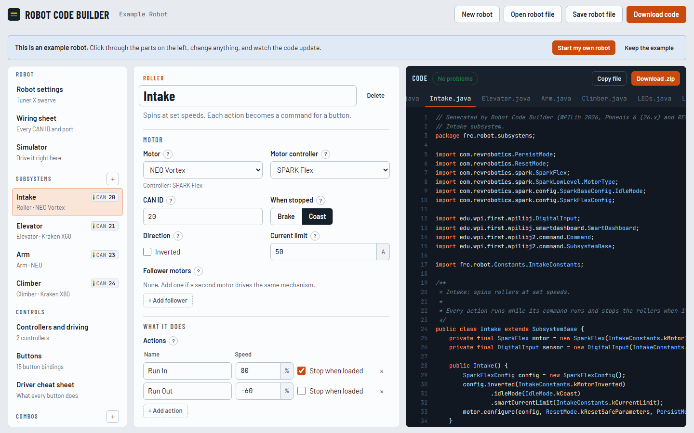
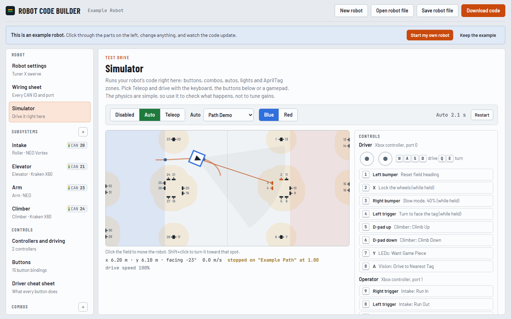
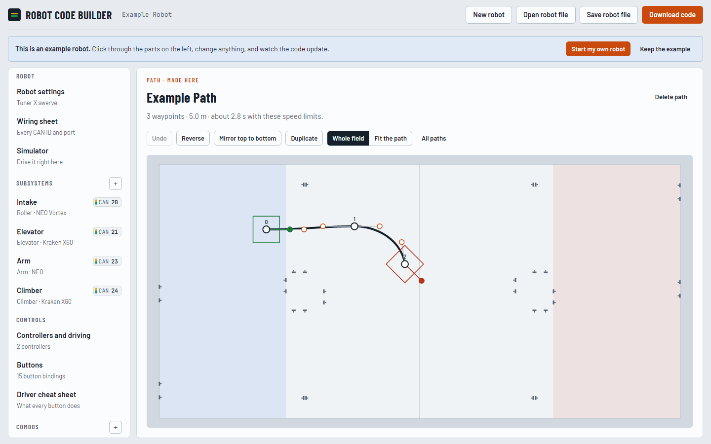

# Robot Code Builder

Fill in what's on your FRC robot and get WPILib 2026 Java code you can build and deploy. It is made for teams whose swerve drive comes from the Phoenix Tuner X Swerve Project Generator: it keeps your swerve code and writes everything else.

**Open the app: https://knnightterrror.github.io/robot-code-builder/**



## What it makes

- **Subsystems:** rollers and intakes, flywheels, elevators, arms, climbers and pneumatic pistons. Kraken X60 and X44, Falcon 500, NEO, NEO Vortex and NEO 550 on Talon FX, SPARK MAX or SPARK Flex, with followers, current limits, beam breaks or CANrange sensors, Through Bore and CANcoder absolute encoders, limit switches and soft limits.
- **Driving and buttons:** Xbox, PS4, PS5 and joystick controllers. Buttons that run while held, when pressed, as a toggle or when released. Slow mode, wheel lock, heading reset, rumble alerts and a printable driver cheat sheet.
- **Combos:** several actions in a row from one button.
- **Lights:** CANdle, REV Blinkin or an LED strip, with status rules ("green when we have a game piece") and signals.
- **AprilTag vision:** Limelight pose estimates (MegaTag1 and MegaTag2), aim at a tag, drive to a spot in front of a tag, zones that slow the robot down, change the LEDs or run an action, and distance tables for shooter speed or arm angle.
- **Autonomous:** step-by-step routines, PathPlanner named commands and the auto chooser, and actions at spots along a path: stop there and run something, or run it while driving until a later spot, for a set time, or until the path ends.
- **Paths:** draw and edit PathPlanner paths in the app, or import the ones you made in PathPlanner.
- **Tuning tools:** live tuning from the dashboard, SysId routines and WPILib simulation models.
- **Every download** has a README with the steps for that robot, a wiring sheet of every CAN ID and port, and checks for mistakes such as two devices on one CAN ID.

## The simulator

The app has a simulator that runs your robot's code in the browser. Drive with the keyboard, the on-screen buttons or a gamepad, and watch your buttons, combos, autos, LED rules, AprilTag zones and PathPlanner autos run on the 2026 field.





## How to use it

1. Make your swerve project with the Phoenix Tuner X Swerve Project Generator and open it in WPILib VS Code. (No swerve? Turn it off under Robot settings.)
2. Open the app and press **Start my own robot**, or change the example robot.
3. Add your subsystems, controllers, buttons, autos and lights.
4. Press **Download code**, copy the `src` folder from the zip into your project, and follow the README.txt in the zip. It lists the vendor libraries to install (Phoenix 6, REVLib, PathPlannerLib) and what to check before enabling.

Press **Save robot file** to keep your robot as a `.robot.json` file you can share with your team or keep in your robot repo. The app also remembers the last robot in your browser.

Everything runs in your browser. Your robot is never sent to a server.

The code targets WPILib 2026, Phoenix 6 (26.x), REVLib 2026 and PathPlannerLib 2026, in Java. Generated code is a starting point: put the robot on blocks, check that every motor turns the right way, and tune the gains.

## Working on the app

The app is plain JavaScript with no dependencies to install. `tools/build.js` puts the pieces together into one HTML file.

| Path | What it is |
| --- | --- |
| `src/gen.js` | The code generator: catalogs, the robot model, checks and the Java writers. Runs in the browser and in Node. |
| `src/sim.js` | The simulator: command scheduler, mechanism physics, swerve, vision and PathPlanner paths. |
| `src/app.js` | The page: forms, path editor, file import and downloads. |
| `src/page.html` | Layout and styles. |
| `docs/index.html` | The built website that GitHub Pages serves. Don't edit it by hand. |
| `tools/` | Build script and tests. |

```bash
node tools/build.js
```

Run `node tools/build.js` after changing anything in `src/`, and commit `docs/index.html` with your change so the website updates.

### Tests

```bash
node tools/test.js out
node tools/simtest.js
```

- `tools/test.js out` generates Java for a set of test robots into `out/`.
- `tools/simtest.js` checks the simulator: mechanisms, buttons, autos, AprilTag features, paths and PathPlanner autos.

Two more checks use the real libraries and need WPILib 2026 installed (Windows, `C:\Users\Public\wpilib\2026`) plus the Phoenix 6, REVLib and PathPlannerLib jars in your Gradle cache (build any robot project that uses them once):

```bash
bash tools/compile.sh out
bash tools/pathcheck.sh out work
```

- `tools/compile.sh out` compiles every generated robot against the real jars.
- `tools/pathcheck.sh out work` runs the generated `PathSteps.java` with the real PathPlannerLib and command scheduler in simulated time.

No Node? WPILib's VS Code can run the scripts: `ELECTRON_RUN_AS_NODE=1 "C:/Users/Public/wpilib/2026/vscode/Code.exe" tools/build.js`.

## License

MIT. See [LICENSE](LICENSE).

Not affiliated with FIRST, WPI, CTR Electronics, REV Robotics, Limelight or PathPlanner.
